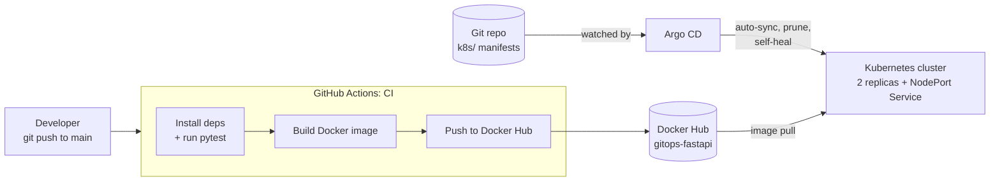

# CI-CD
# GitOps CI/CD Pipeline: FastAPI → Docker → Kubernetes (Argo CD)

[](https://github.com/ehsanrezaiegit/CI-CD/actions/workflows/ci.yml)


A small but complete end-to-end delivery pipeline. Every push to `main` is tested and packaged into a Docker image by **GitHub Actions**, and **Argo CD** keeps a Kubernetes cluster in sync with the manifests stored in this repository (GitOps).

The application itself is intentionally tiny (a FastAPI service with a health endpoint). The point of the project is the **delivery workflow around it**.

## How it works



1. **CI (GitHub Actions)**: on every push to `main` the workflow checks out the code, sets up Python 3.9, installs dependencies, runs the test suite with `pytest`, logs in to Docker Hub and builds and pushes the image. Because the steps run in order, a failing test stops the pipeline before any image is published.
2. **CD (Argo CD)**: Argo CD watches the `k8s/` folder of this repository and applies it to the cluster. With `automated` sync, `prune` and `selfHeal` enabled, the cluster always converges back to what Git says, and manual drift is reverted.

## Repository structure

| Path | Purpose |
|---|---|
| `main.py` | FastAPI app with `GET /` and `GET /health` |
| `test_main.py` | `pytest` test for the health endpoint (FastAPI `TestClient`) |
| `requirements.txt` | Pinned dependencies (FastAPI, Uvicorn, pytest, httpx) |
| `Dockerfile` | Container image (`python:3.9-slim`, Uvicorn on port 8000) |
| `.github/workflows/ci.yml` | CI pipeline: test → build → push |
| `k8s/app.yaml` | Kubernetes `Deployment` (2 replicas) and `Service` (NodePort, 80 → 8000) |
| `argocd-app.yaml` | Argo CD `Application` with automated sync, prune and self-heal |

## Run locally

```bash
# Option 1: Python
pip install -r requirements.txt
uvicorn main:app --reload
# → http://127.0.0.1:8000

# Option 2: Docker
docker build -t gitops-fastapi .
docker run -p 8000:8000 gitops-fastapi

# Check it
curl http://127.0.0.1:8000/health
# {"status":"healthy"}
```

Run the tests:

```bash
pytest
```

## Set up the pipeline in your own fork

1. **Docker Hub secrets**: in *Settings → Secrets and variables → Actions*, add:
   - `DOCKER_USERNAME`
   - `DOCKER_PASSWORD` (use a Docker Hub access token)
2. **Point the manifests to your image**: in `k8s/app.yaml`, replace `erzgang/gitops-fastapi:latest` with `<your-dockerhub-username>/gitops-fastapi:latest`.
3. **Point Argo CD to your repo**: in `argocd-app.yaml`, change `repoURL` to your fork.
4. Push to `main` and watch the **Actions** tab.

## Deploy with Argo CD

Requires a running Kubernetes cluster (for example `kind` or `minikube`) and `kubectl`.

```bash
# 1. Install Argo CD
kubectl create namespace argocd
kubectl apply -n argocd -f https://raw.githubusercontent.com/argoproj/argo-cd/stable/manifests/install.yaml

# 2. Register the application (GitOps starts here)
kubectl apply -f argocd-app.yaml

# 3. Verify
kubectl get pods
kubectl port-forward svc/fastapi-service 8080:80
curl http://127.0.0.1:8080/health
```

From now on, any change committed to `k8s/` (for example `replicas: 2` → `3`) is applied to the cluster automatically, with no manual `kubectl` commands.

## Tech stack

Python · FastAPI · Uvicorn · pytest · Docker · GitHub Actions · Kubernetes · Argo CD

## Known limitations and roadmap

This is a learning and portfolio project, and these are the things I would change before using the pattern in production:

- [ ] **Immutable image tags.** The image is pushed as `:latest`. Argo CD only reacts to changes in Git, so a new image under the same tag is not rolled out automatically. The fix is to tag images with the commit SHA and have CI update the tag in `k8s/` (or use Argo CD Image Updater).
- [ ] **Health probes and resource limits** in `k8s/app.yaml` (`/health` already exists for this).
- [ ] **Run tests on pull requests**, not only on pushes to `main`.
- [ ] **Image vulnerability scanning** (for example Trivy) before the push step.
- [ ] **Upgrade the base image.** Python 3.9 is past end-of-life, so move to a supported version.
- [ ] **Separate staging and production** environments (Kustomize overlays or Helm values).

## Related projects

- [mini-cloud-platform](https://github.com/ehsanrezaiegit/mini-cloud-platform): a local Kubernetes platform built with OpenTofu, Ansible, Helm and Argo CD
- [devops-monitoring-lab](https://github.com/ehsanrezaiegit/devops-monitoring-lab): Prometheus, Alertmanager and Grafana with an incident simulator

## Author

**Ehsan Rezaie**: DevOps & Full-Stack Engineer · [GitHub](https://github.com/ehsanrezaiegit) · [Portfolio](https://plugifly.shop)
